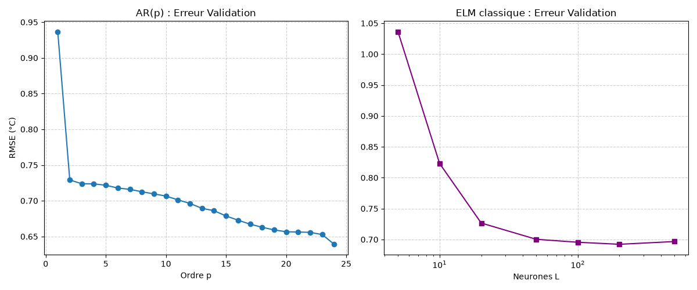
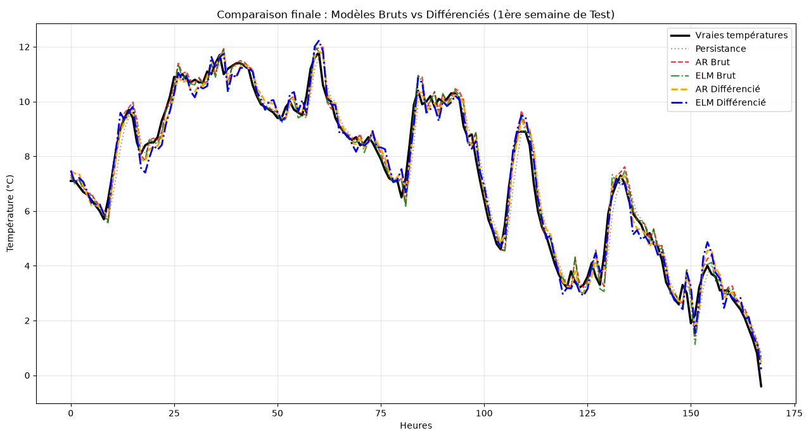

# Séries Temporelles de la Température à Paris

Ce projet vise à modéliser et prévoir l'évolution de la température à Paris en comparant plusieurs approches statistiques et d'apprentissage automatique (Persistance, Autorégressif linéaire AR, et Réseaux de Neurones ELM), appliquées sur des séries temporelles brutes et différenciées.
---

## 1. Présentation des Données
* **Domaine :** Météorologie (Température de l'air à Paris).
* **Pas de temps :** Horaire ($1 \text{ pas} = 1 \text{ heure}$).
* **Volume de données :** Découpage chronologique strict sur 3 blocs distincts (représentant environ 1 année chacun).
  * **Apprentissage ($N_{train}$) :** 8 760 heures (pour ajuster les poids $w$ et $\beta$).
  * **Validation ($N_{val}$) :** 8 760 heures (pour optimiser les hyperparamètres $p$ et $L$).
  * **Test ($N_{test}$) :** 8 760 heures (pour l'évaluation finale en conditions réelles).

---

## 2. Analyse Statistique et Physique des Séries

Avant modélisation, une analyse descriptive a été menée pour comprendre la dynamique physique de la température.

| Statistique | Série Brute ($x$) | Série Différenciée ($y_t = x_t - x_{t-1}$) |
| :--- | :--- | :--- |
| **Moyenne** | 12.8983 °C | 0.0005 °C |
| **Écart-type ($\sigma$)** | 7.4401 °C | 1.0145 °C |
| **Asymétrie** | 0.1525 | 0.1359 |
| **Aplatissement** | 2.6818 | 3.9383 |

**Interprétation physique :**
* **La série brute** montre une moyenne cohérente avec le climat parisien (~12.9°C) et une forte dispersion ($\sigma = 7.44°C$) causée par les grands cycles diurnes et saisonniers. 
* **La série différenciée** annule l'inertie thermique. La moyenne tombe à 0 (pas de réchauffement global drastique sur l'année) et surtout, **l'écart-type chute à 1.01°C**. Physiquement, cela prouve que d'une heure à l'autre, la température varie très peu (stationnarité). L'aplatissement (3.93 > 3) indique des "queues épaisses" : les variations sont majoritairement minuscules, avec de rares changements brusques (ex: passage d'un front froid).

---

## 3. Optimisation des Modèles (Phase de Validation)

L'observation du graphique nous permet de comprendre le comportement des modèles :

1. **AR(p) - Le choix du retard :** L'erreur de validation chute drastiquement entre $p=1$ et $p=2$, prouvant que le modèle a besoin d'au moins deux heures d'historique pour comprendre la "dynamique" (la dérivée) de la courbe. L'erreur continue de baisser doucement jusqu'à $p=24$ (cycle journalier complet). Le modèle brut présenté ici retient **AR(4)** pour un compromis simplicité/efficacité, tandis que le modèle différencié utilise **AR(24)**.
2. **ELM - Le choix des neurones cachés ($L$) :** Le graphique en échelle logarithmique montre que l'erreur s'effondre rapidement jusqu'à $L \approx 50$. Au-delà de $L=200$, la courbe stagne. Nous avons donc retenu **L=200** (ou $L=500$ pour l'intégration du calendrier) pour maximiser la capacité non linéaire sans surcharger les calculs.

---

 |

---

# 4. Analyse Physique et Comparaison des Modèles

D'après les métriques et les graphiques de prévision  :

### A. La force de l'inertie thermique (Persistance)
La persistance réalise un score tout à fait honorable (nRMSE = 7.22%). La température de l'air ayant une inertie physique très forte, l'heure actuelle est un excellent prédicteur de l'heure suivante. Battre la persistance (NICE < 1) exige des modèles capables de capter l'inversion de tendance (le lever ou le coucher du soleil).

### B. Modèles Bruts vs Variables Temporelles
* L'**ELM Brut** (5.66%) bat légèrement l'**AR(4)** (5.82%) grâce à la non-linéarité de sa fonction d'activation $\tanh$ qui gère mieux les extrêmes de température.
* Cependant, le grand gagnant de cette étude est l'**ELM enrichi par le calendrier (Sin/Cos)** avec un nRMSE de 5.07%. **Explication physique :** La température est une conséquence directe du forçage solaire (rotation de la Terre sur elle-même et autour du Soleil). En fournissant explicitement l'heure et le jour (via un encodage circulaire $\sin/\cos$), le réseau n'a plus à "deviner" le cycle à partir des retards : il sait exactement où il se trouve dans la journée.

### C. Le rôle crucial de la Différenciation
Le graphique `Differencier vs Brut.png` et les scores illustrent brillamment l'intérêt de la stationnarité :

* L'**AR(24) Différencié** (5.12%) réalise des performances presque équivalentes à l'ELM complexe. En modélisant uniquement la variation ($\Delta T$) et en l'ajoutant à la persistance ($\hat{x}_{t+1} = x_t + \hat{y}_{t+1}$), l'AR est soulagé des grandes tendances saisonnières.
* La différenciation permet à l'algorithme de se concentrer exclusivement sur la "dynamique" immédiate, ce qui réduit considérablement le risque d'erreurs importantes lors des pics journaliers, comme le montre le suivi extrêmement fidèle des prédictions différenciées (courbes orange et bleue) sur la courbe réelle noire.
