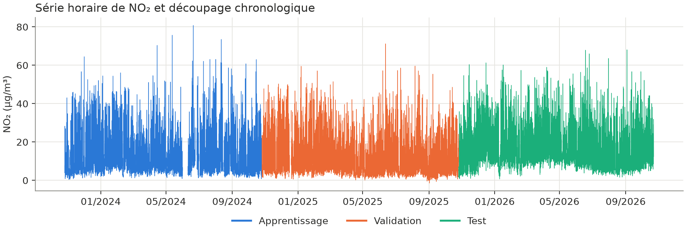
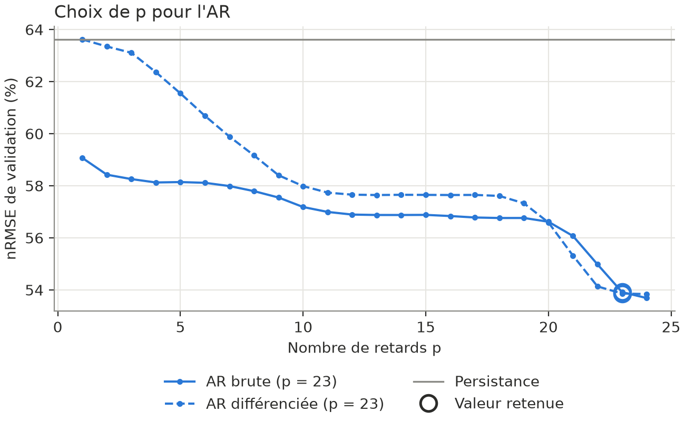
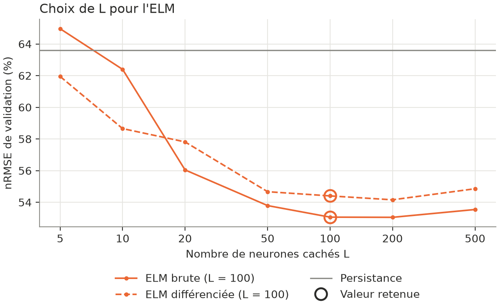
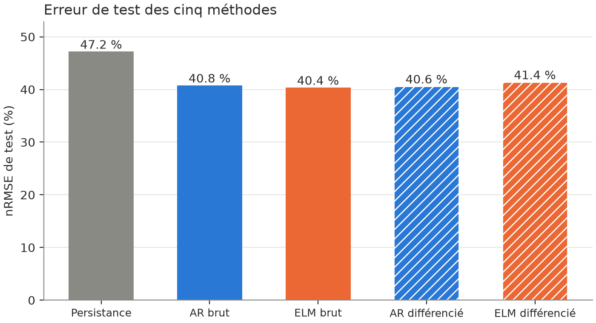
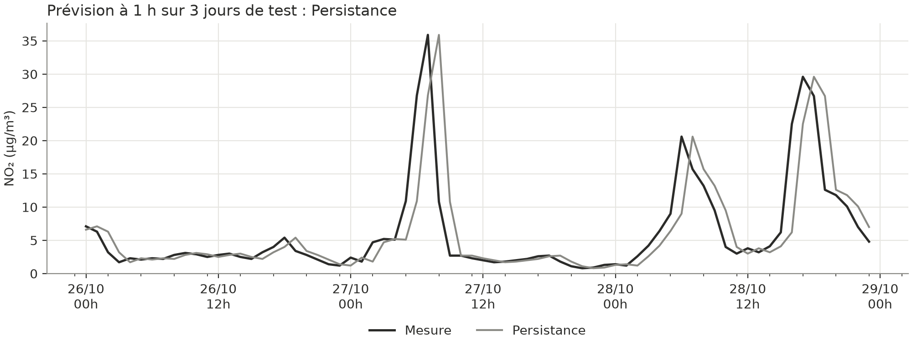
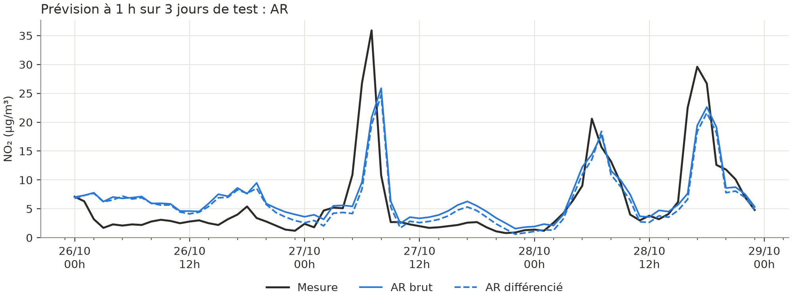
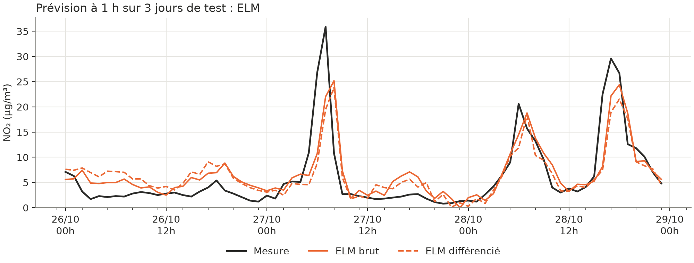

# Prévision à 1 h du NO₂ à Ajaccio (Tarik)

Série : NO₂ horaire (µg/m³), station Ajaccio Canetto, export Géod'Air « moyenne horaire validée » (`data/data_tarik.csv`, du 26/10/2023 au 22/10/2026, 26 232 heures). Licence à confirmer : le jeu Géod'Air « temps réel » est en Licence Ouverte v2.0.

Les 591 heures manquantes sont interpolées linéairement quand le trou fait 24 h ou moins (113 heures). Les trous plus longs restent vides et ne sont pas utilisés.

Apprentissage : 26/10/2023 → 25/10/2024 (8 784 h). Validation : → 25/10/2025 (8 760 h). Test : → 22/10/2026 (8 688 h).

## Réglages

Choisis sur la validation (plus petite valeur à moins de 0,5 % du minimum) : p = 23 pour l'AR et l'ELM, L = 100 pour l'ELM, en brut comme en différencié.

## Résultats sur le test

| | nMBE (%) | nMAE (%) | nRMSE (%) | R² | NICEΣ |
|---|---|---|---|---|---|
| Persistance | −0,004 | 30,392 | 47,207 | 0,4411 | 1,0000 |
| AR | −2,377 | 27,375 | 40,786 | 0,5828 | 0,8753 |
| ELM | −0,461 | 27,326 | 40,364 | 0,5914 | 0,8676 |
| AR diff. | 0,081 | 27,560 | 40,609 | 0,5864 | 0,8734 |
| ELM diff. | 0,143 | 28,239 | 41,417 | 0,5698 | 0,8913 |

## Analyse

L'ELM brut est le meilleur (nRMSE 40,364 % contre 47,207 % pour la persistance), mais son avance sur l'AR (0,42 point) est du même ordre que l'effet du tirage aléatoire (20 tirages à L = 100 : de 40,34 à 40,97 %). La différenciation supprime le biais de l'AR (−2,377 % → 0,081 %) mais dégrade l'ELM (40,364 % → 41,417 %). Le gain sur la persistance reste modeste : la série différenciée garde 73 % de l'écart-type de la série brute (7,398 contre 10,138) et un kurtosis élevé (8,799). Les pics de pollution, sous-estimés par tous les modèles, ne se devinent pas à partir du passé de la série.

p = 23 est proche du bord de la grille (1 à 24).

## Lancer le code

Depuis `code/tarik/` : `python main.py` (option `--show` pour afficher les figures). Le tableau est écrit dans `Resultats/tarik/results.csv`.